# _IsoNet2_

## Contents

- [Overview](#0-overview)
- [Installation and System Requirements](#1-installation-and-system-requirements)
- [Tutorial](#2-tutorial)
- [IsoNet2 Modules](#3-isonet2-modules)
- [FAQs](#4-faqs)

# 0. Overview

_IsoNet2_ is a deep-learning software package for simultaneous missing wedge correction, denoising, and CTF correction in cryo-electron tomography reconstructions using a deep neural network trained on information from the original tomogram(s). Compared to IsoNet1 [(DOI: 10.1038/s41467-022-33957-8)](https://www.nature.com/articles/s41467-022-33957-8), _IsoNet2_ produces tomograms with higher resolution and less noise in roughly a tenth of the time. The software requires full tomograms or even/odd paired tomograms as input. Paired tomograms for Noise2Noise training can be split by either frame or tilt.

_IsoNet2_ contains six modules: **_prepare_star_**, **_deconv_**, **_make_mask_**, **_denoise_**, **_refine_**, and **_predict_**. All commands in IsoNet operate on `.star` text files which record paths of data and relevant parameters. For detailed descriptions of each module please refer to the individual tasks. Users can choose to utilize IsoNet through either GUI or command-lines.

We maintain an IsoNet Google group for discussions or news. To subscribe or visit the group via the web interface please visit [https://groups.google.com/u/1/g/isonet](https://groups.google.com/u/1/g/isonet). To post to the forum you can either use the web interface or email to isonet@googlegroups.com

# 1. Installation and System Requirements

## Prerequisites

### Computing Resources

IsoNet2 is optimized for high-performance GPU computing.

- Supported Hardware: NVIDIA GPUs (Ampere architecture or newer recommended).
- Memory: 24 GB VRAM recommended.
    - _Low-memory environments: Users with limited VRAM must adjust configuration parameters (specifically cube and batch sizes) to ensure stability._

### Software Environment

- Operating System: Linux (64-bit).
- Validation: Validated on Rocky Linux 8.6; compatible with most standard Linux distributions.

### Python Dependencies

All dependencies can be found in the `isonet2_environment.yml` file.

## Installing [Conda](https://docs.conda.io/projects/conda/en/latest/user-guide/getting-started.html)

- Download your `conda-installer`:
    - [Miniconda](https://www.anaconda.com/docs/getting-started/miniconda/main) installer for Linux (use this if you're new).

    - [Anaconda Distribution](https://www.anaconda.com/download) installer for Linux.

    - [Miniforge](https://conda-forge.org/download/) installer for Linux.

- Verify your installer [hashes](https://docs.conda.io/projects/conda/en/latest/user-guide/install/index.html#hash-verification).

- In your terminal window, run `bash <conda-installer>-latest-Linux-x86_64.sh`

- Follow the prompts on the installer screens. If you are unsure about any setting, accept the defaults. You can change them later.

- Close and then re-open your terminal window.

- After successful installation, running the command conda list should display a list of installed packages.

## Installing [CUDA](https://docs.nvidia.com/cuda/cuda-installation-guide-linux/index.html)

- Find information on your GPU for [Linux](https://itsfoss.com/check-graphics-card-linux/).

- Look up your GPU to make sure it is supported. If its [CUDA GPU Compute Capability](https://developer.nvidia.com/cuda-gpus) is below **_3.5_**, you will not be able to run IsoNet2.

- Reference your Toolkit Driver Version in _Table 3_ on the [CUDA Toolkit Docs.](https://docs.nvidia.com/cuda/cuda-toolkit-release-notes/index.html#cuda-major-component-versions__table-cuda-toolkit-driver-versions) to see that it has a corresponding CUDA Version >= 11.8 _(Toolkit Driver Version >=520.61.05)_.

- Make sure you have installed the sufficient graphics card driver version for your GPU from the [NVIDIA driver page](https://www.nvidia.com/en-us/drivers/).
- Select the [CUDA Toolkit](https://developer.nvidia.com/cuda-toolkit-archive) version that matches what you read in _Table 3_ and follow the install instructions.

After successfully installing, you can check your CUDA version using `nvidia-smi`, which should produce something similar to below:

```
+---------------------------------------------------------------------------------------+
| NVIDIA-SMI 535.129.03             Driver Version: 535.129.03   CUDA Version: 12.2     |
|-----------------------------------------+----------------------+----------------------+
| GPU  Name                 Persistence-M | Bus-Id        Disp.A | Volatile Uncorr. ECC |
| Fan  Temp   Perf          Pwr:Usage/Cap |         Memory-Usage | GPU-Util  Compute M. |
|                                         |                      |               MIG M. |
|=========================================+======================+======================|
|   0  NVIDIA A100 80GB PCIe          Off | 00000000:01:00.0 Off |                    0 |
| N/A   34C    P0              41W / 300W |     18MiB / 81920MiB |      0%      Default |
|                                         |                      |             Disabled |
+-----------------------------------------+----------------------+----------------------+
|   1  NVIDIA A100 80GB PCIe          Off | 00000000:25:00.0 Off |                    0 |
| N/A   36C    P0              46W / 300W |     18MiB / 81920MiB |      0%      Default |
|                                         |                      |             Disabled |
+-----------------------------------------+----------------------+----------------------+
|   2  NVIDIA A100 80GB PCIe          Off | 00000000:81:00.0 Off |                    0 |
| N/A   35C    P0              46W / 300W |     18MiB / 81920MiB |      0%      Default |
|                                         |                      |             Disabled |
+-----------------------------------------+----------------------+----------------------+
|   3  NVIDIA A100 80GB PCIe          Off | 00000000:C1:00.0 Off |                    0 |
| N/A   37C    P0              46W / 300W |     18MiB / 81920MiB |      0%      Default |
|                                         |                      |             Disabled |
+-----------------------------------------+----------------------+----------------------+

+---------------------------------------------------------------------------------------+
| Processes:                                                                            |
|  GPU   GI   CI        PID   Type   Process name                            GPU Memory |
|        ID   ID                                                             Usage      |
|=======================================================================================|
|    0   N/A  N/A      3610      G   /usr/lib/xorg/Xorg                            4MiB |
|    1   N/A  N/A      3610      G   /usr/lib/xorg/Xorg                            4MiB |
|    2   N/A  N/A      3610      G   /usr/lib/xorg/Xorg                            4MiB |
|    3   N/A  N/A      3610      G   /usr/lib/xorg/Xorg                            4MiB |
+---------------------------------------------------------------------------------------+

```

## Installing IsoNet2

### GUI Installation

Download the source archive and `isoapp.AppImage` from the [IsoNet2 releases page](https://github.com/IsoNet-cryoET/IsoNet2/releases). Extract the source archive into your desired installation folder and place `isoapp.AppImage` in the extracted IsoNet2 directory. The GUI is provided as a separate release asset and follows the IsoNet2 release version.

### non-GUI Installation

Alternatively, if you only plan to use our command-line interface (CLI), you can clone this repository by running `git clone https://github.com/IsoNet-cryoET/IsoNet2.git` in your desired installation folder. This will not contain the compiled GUI file.

Once you have installed IsoNet2, navigate to your installation folder and run `cd IsoNet2` and `bash install.sh`. This uses the included `isonet2_environment.yml` file to create a new Conda environment and runs `source <your_installation_directory>/IsoNet2/isonet2.bashrc` to tell your shell the location of `isonet.py`. You may want to append this command to your `.bashrc` file so you don't have to re-source it every time you wish to use IsoNet.

Installation should take 5-10 minutes. Upon successful installation, activate your environment by running `conda activate isonet2_environment`. Running the command `isonet.py --help` should display the following help message.

```
INFO: Showing help with the command 'isonet.py -- --help'.

NAME
    isonet.py - ISONET: Train on tomograms to simultaneously perform missing wedge correction, CTF correction, and denoising.

...
```

# 2. Tutorial

The following tutorial outlines the basic _IsoNet2_ workflow on 5 immature HIV-1 dMACANC VLP even/odd paired tomograms using the [GUI](#21-gui) and [CLI](#22-command-line-interface).

In-depth explanations for every parameter can be found under Section [**3. \***IsoNet2**\* Modules.**](#3-isonet2-modules) The tutorial dataset, along with a video tutorial, can be found in the following [Box](https://ucla.box.com/v/isonet2tutorial) drive.


**Fig. 1.** XZ slices and corresponding Fourier space of HIV tomograms 1) reconstructed with weighted back projection 2) CTF-deconvolved 3) CTF-corrected and denoised 4) CTF-corrected, denoised, and missing-wedge corrected.

## 2.0 Download Tomograms

In a new working directory, download and extract the `tomograms_split` folder from the link above.


**Fig. 2.** XY slices of even HIV tomograms reconstructed with weighted back projection.

## 2.1 GUI

The _IsoNet2_ GUI provides intuitive, detailed, and organized process management. The interface provides tools for dataset organization, parameter configuration, job submission, and real-time process monitoring. Entry points for the main processing steps are kept in a left-hand menu, while the central panel shows the program’s live output during a run, allowing users to view refinement in real time and make adjustments as needed.

### 2.1.0 Launch GUI

Launch the GUI by typing `IsoNet2` in your terminal. If you encounter issues with your machine and the SUID sandbox, run `IsoNet2 -no-sandbox` instead.

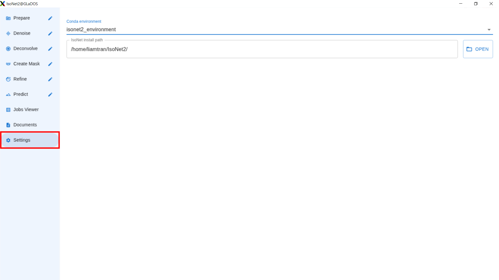
Once the GUI opens, select the **_Settings_** Tab to select your **conda environment** and **IsoNet Install Path**. These will be saved to your `~/.config/isoapp/environment.json` and loaded in every time you open the GUI.

### 2.1.1 Prepare Star for Mask

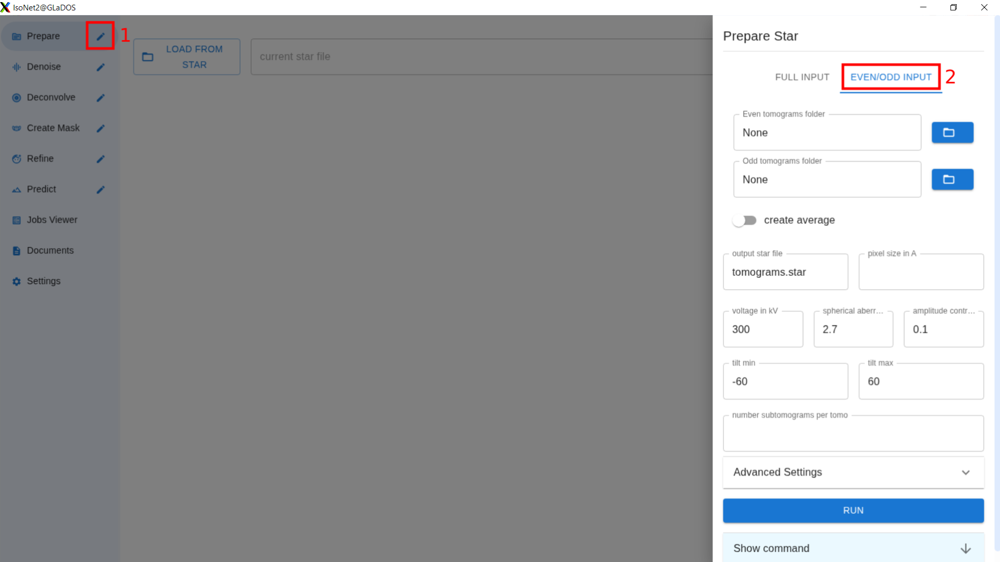
Open the **_Prepare_** tab and select **Even/Odd Input**.

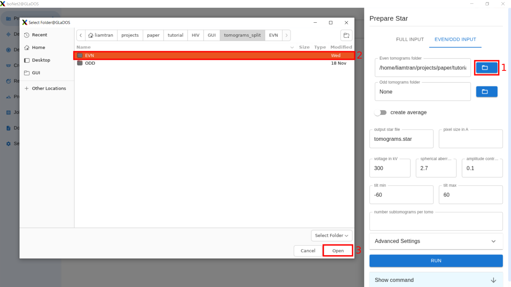
Select your **even** dataset in the popup directory. Do the same for your **odd** dataset.

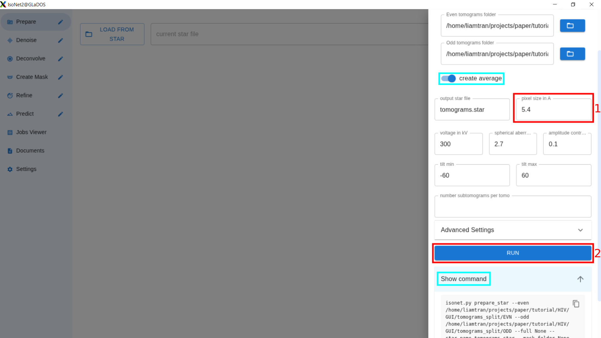
Set your **pixel size in Å** to 5.4 and leave the other parameters at their default values. Then select **Run**.

You may optionally enable **create_average** to average the half tomograms and reduce noise for the **_Deconvolve_** and **_Create Mask_** modules (more information in Section [**2.1.2: Pre-Mask Processing**](#212-pre-mask-processing)).
For each module, **Show command** provides the `isonet.py` command if you prefer to run it directly in your terminal.

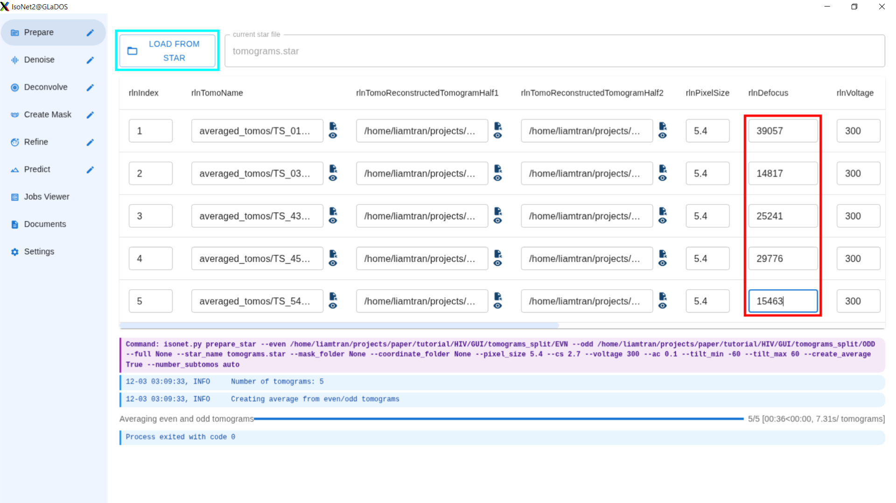
The starfile should automatically display. Fill in the **rlnDefocus** column with the approximate defocus in Å at 0° tilt for each tomogram.

> _If you ran the command in your terminal, or if you have a pre-existing RELION5 starfile, select **Load from Star** and choose the starfile from your working directory._

### 2.1.2 Pre-Mask Processing

_The following options apply CTF correction to improve the signal-to-noise ratio before generating a mask for refinement._

### 2.1.2a Denoise

If you have access to even/odd paired tomograms, as we do in this tutorial, we recommend using the **_Denoise_** module. This provides comparable results to running a full **_Refine_** job and using the corrected tomograms to generate the mask, as done in the _IsoNet2_ paper.

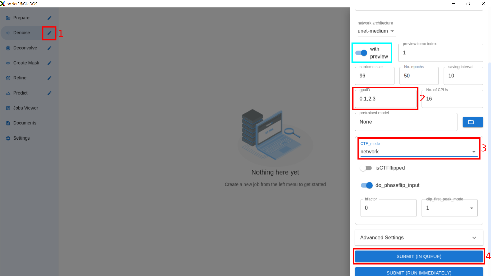
Open the **_Denoise_** tab. Define the appropriate **gpuID**s and select **CTF_mode** network from the dropdown menu. Click **Submit (In Queue)**.

> **\*with preview** enables us to view live predictions from the network.\*

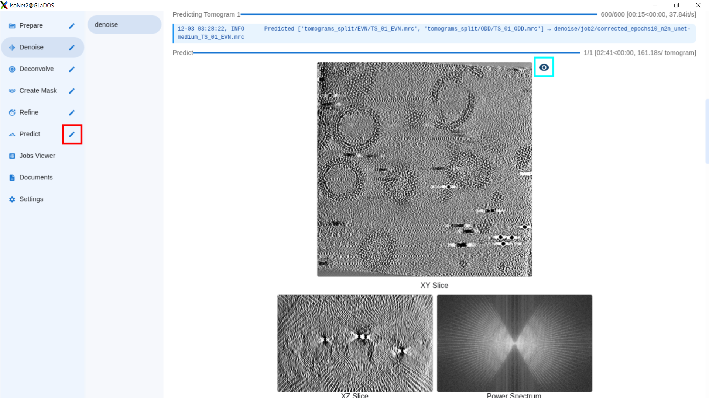
The page should automatically load your progress as the network begins training. The log output `log.txt` and a graph of the loss `loss_full.png` will be saved to `./denoise/<jobID>/`, along with all model files. With **with preview** enabled, the network also saves and displays a prediction for the selected tomograms (via **preview tomo index**) after every **saving interval** (default 10 epochs).

> _Clicking on the eye icon next to our preview will open the denoised tomogram file in IMOD._

### 2.1.2b Predict

Before training finishes, we can already queue a **Predict** job. Open the **_Predict_** tab.

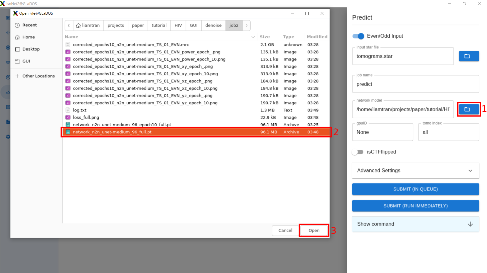
Select the completed model file `network_<method>_<arch>_<cube_size>_full.pt` from the current running job's directory. This handle will always point to the newest version, meaning we can select it now and **_Predict_** will run using the fully trained model once training is completed.

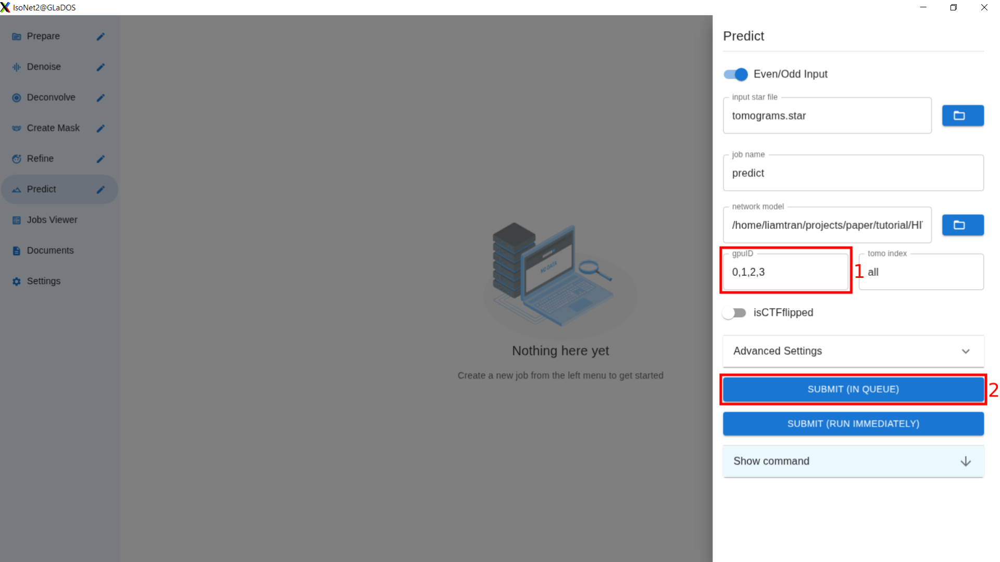
Keep **Even/Odd Input** enabled. Define the appropriate **gpuID**s and click **Submit (In Queue)**.

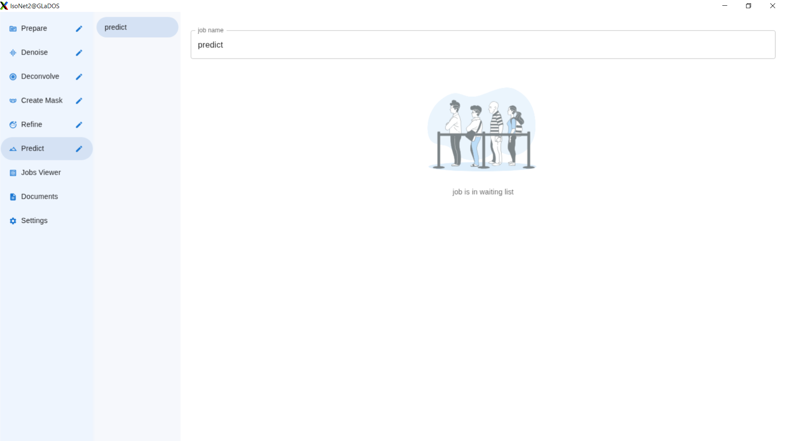
A waiting screen should automatically display. This will be displayed any time you are viewing a job in queue.

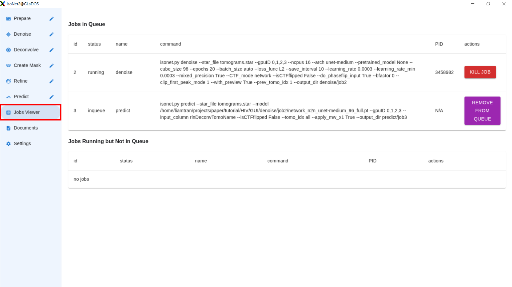
Open the **_Jobs Viewer_** tab. Here, you can manage all your submitted jobs. Jobs that are submitted to run immediately on any of the other pages will bypass the queue and run simultaneously with any current jobs.

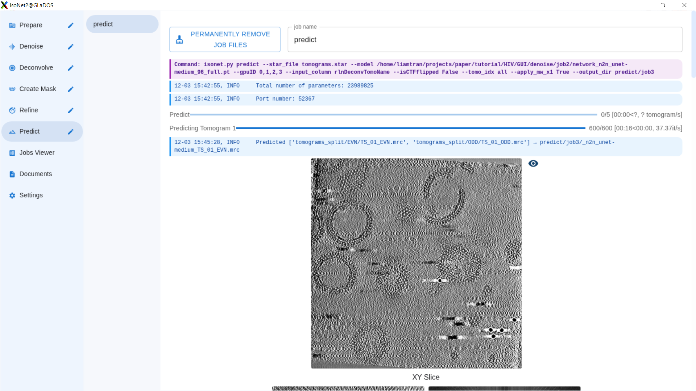
Once our previous job finishes, we can open the **_Predict_** tab again and view the live network outputs for all our tomograms.

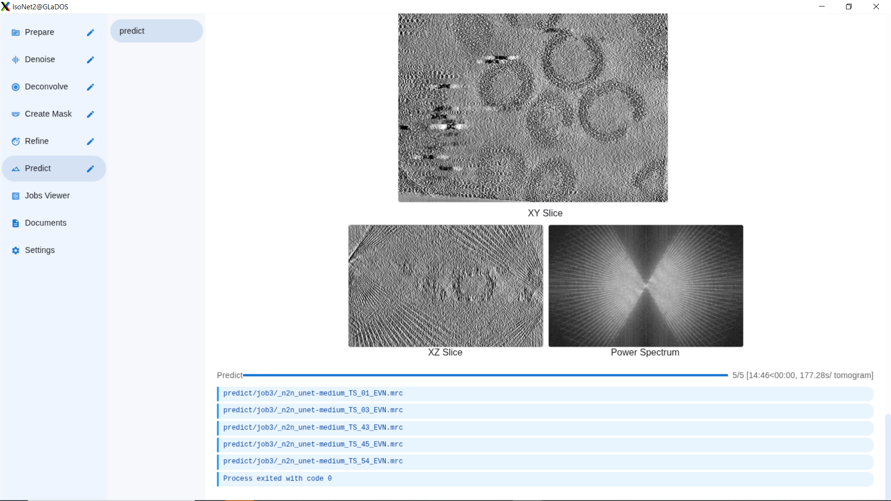
Wait for prediction to finish. Once done, you can view your corrected tomograms at the provided paths.

### 2.1.2c Deconvolve

If you are unable to use the network-based CTF correction in the **_Denoise_** module, you can instead use the **_Deconvolve_** module, inherited from _IsoNet1_, to improve mask quality. While this is relatively quick, it may produce lower quality masks than using **_Denoise_**.

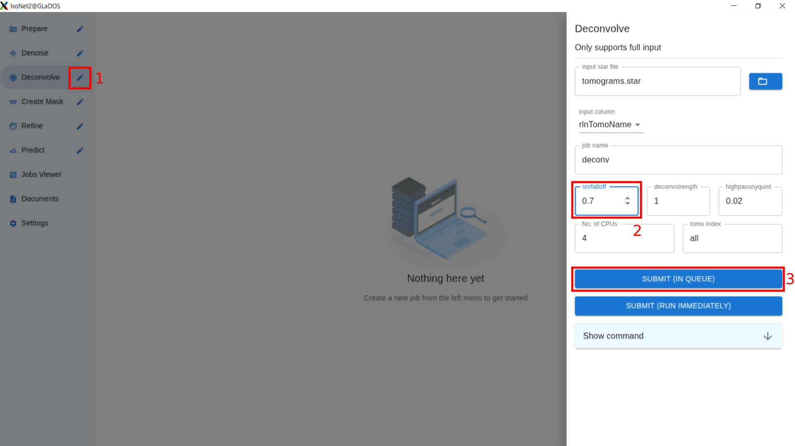
Open the **_Deconvolve_** tab and set **snrfalloff** to 0.7. Click **Submit (In Queue)**.

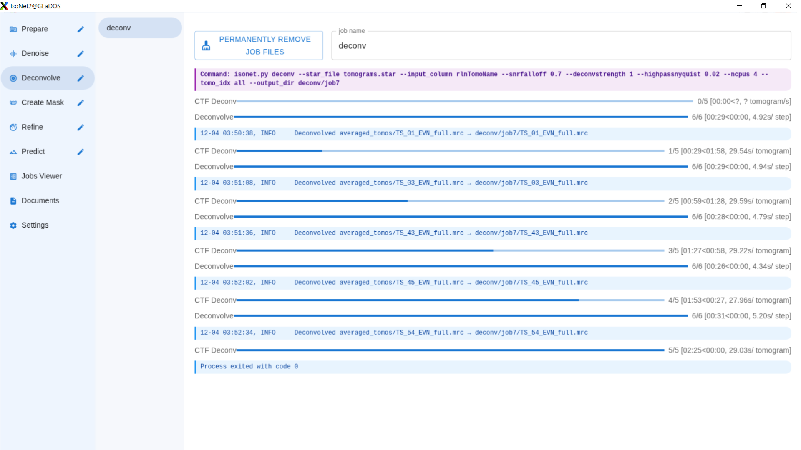
The page should automatically load your progress as the network begins training. The log output `log.txt` will be saved to `./deconv/<jobID>/`, along with all deconvolved tomograms.

### 2.1.3 Create Mask

This step creates masks based on standard deviation and mean density to exclude empty/unwanted areas of each tomogram. During extraction, each subtomogram for training is centered on a valid region of the mask to ensure that it captures a region of interest.

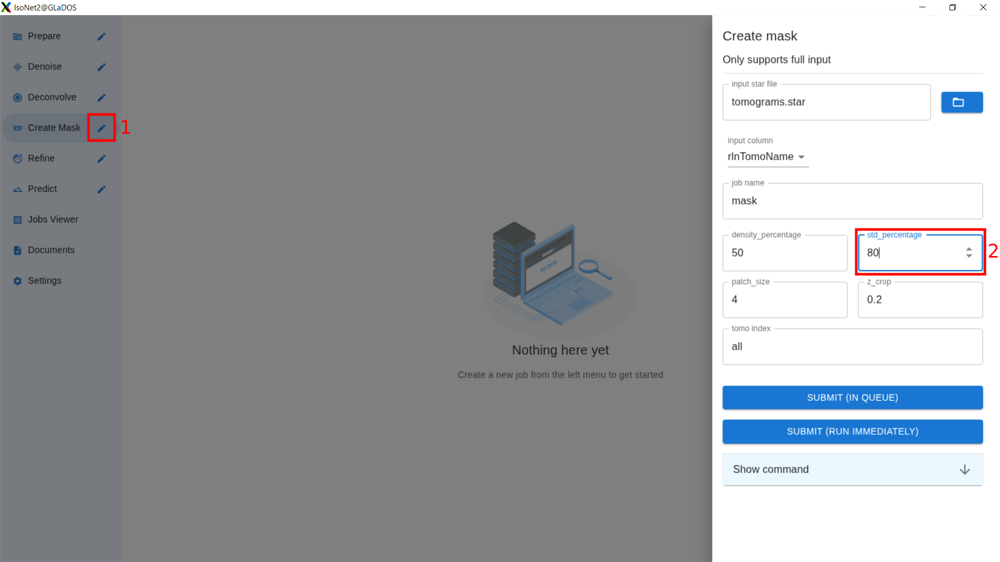
Open the **_Create Mask_** tab and set **std_percentage** to 80.

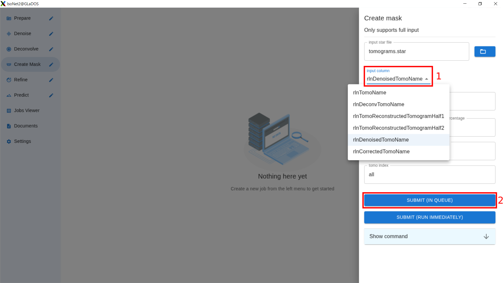
Select your **Input Column**:

1. **rlnDenoisedTomoName** if you used the **_Denoise_** module.
2. **rlnDeconvTomoName** if you used the **_Deconvolve_** module.
3. **rlnCorrectedTomoName** if you are refining a previously refined dataset.
    > _Using the other unprocessed input columns (i.e. rlnTomoName, rlnTomoReconstructedTomogramHalf1) will likely generate poor masks, and is not recommended._

**Submit** your job.

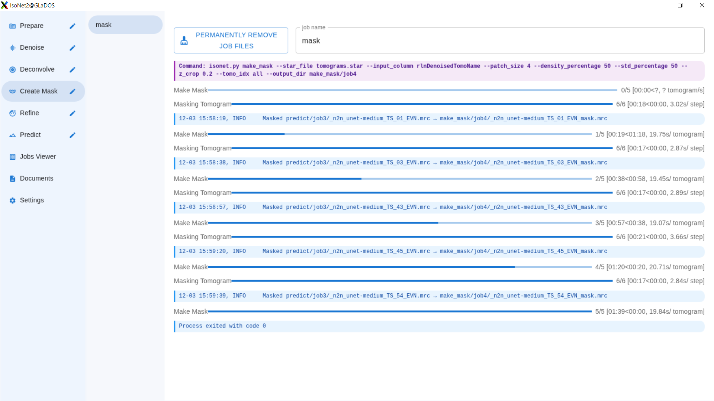
The page should automatically load your progress as the network begins generating masks. The log output `log.txt` will be saved to `./mask/<jobID>/`, along with all masked tomograms.


**Fig. 3.** XY slices and corresponding masks of HIV tomograms that have been 1) reconstructed with weighted back projection, 2) CTF-deconvolved, 3) CTF-corrected and denoised.

### 2.1.5 Refine

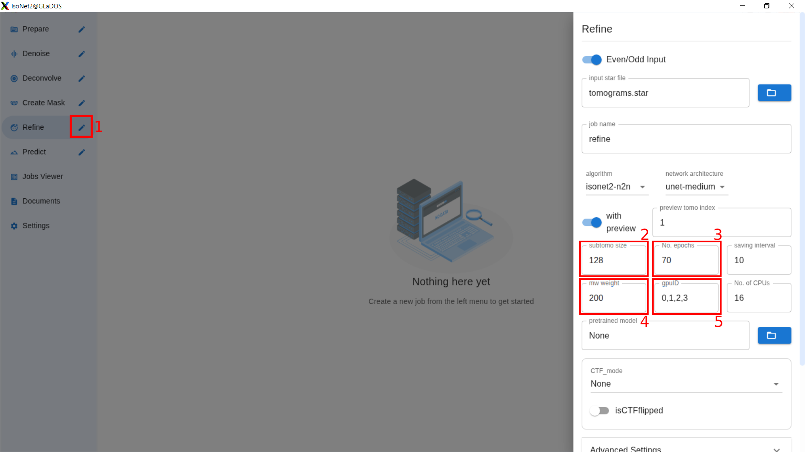
Open the **_Refine_** tab. Keep **Even/Odd Input** enabled. Set **subtomo size** to 128, **No. epochs** to 70, and **mw weight** to 200. Define the appropriate **gpuID**s.

> _If you later encounter issues with insufficient disk space, reduce the **subtomo size** back to the default 96._

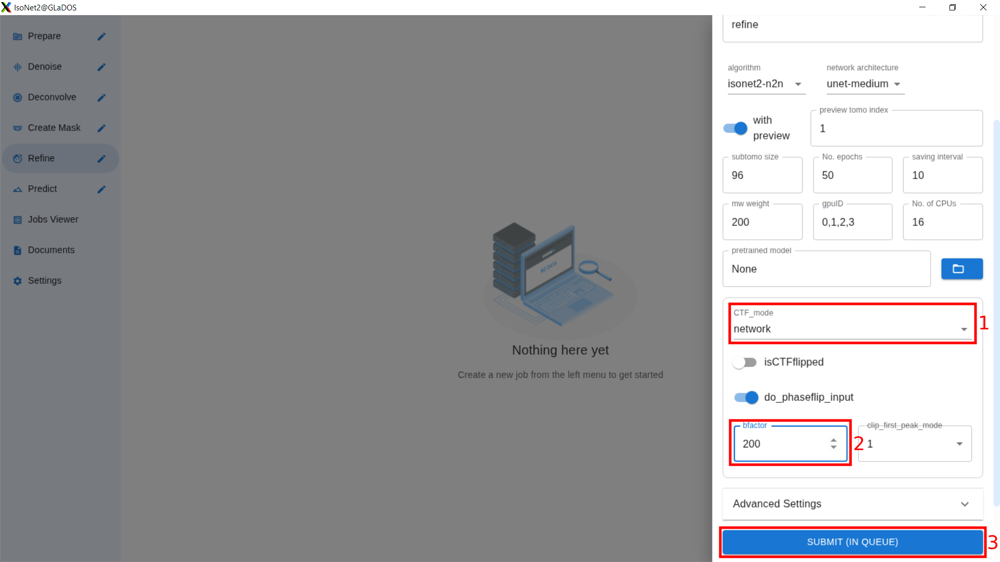
Scroll down, select **CTF_mode** network from the dropdown menu, and set **bfactor** to 200 (**bfactor** should be lower for celluar tomograms. It can be **zero** or even negative). Click **Submit (In Queue)**.

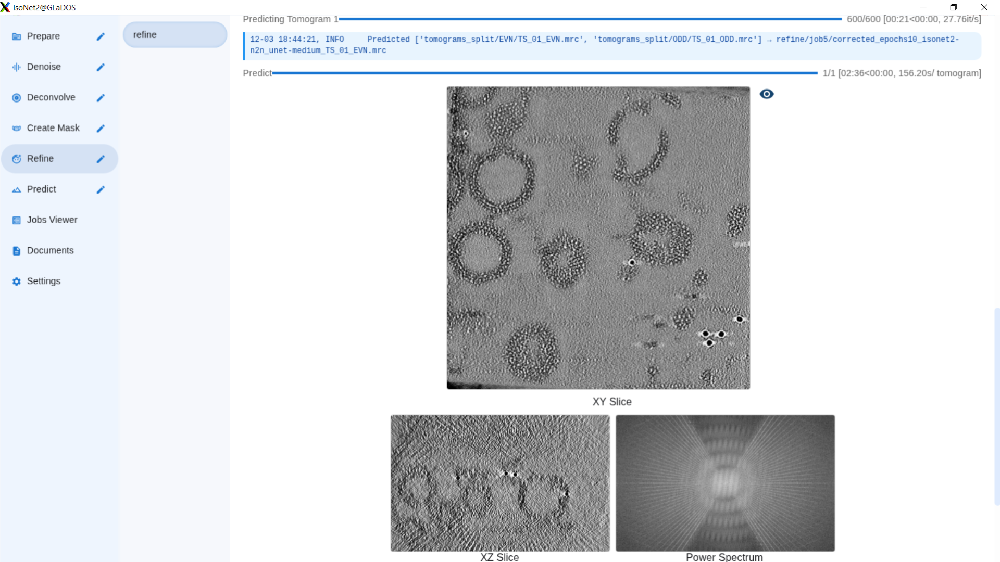
The page should automatically load your progress as the network begins training. The log output, `log.txt`, a graph of the loss, `loss_full.png`, and all model files will be saved to `./refine/<jobID>/`. With **with preview** enabled, the network also saves and displays a prediction for the selected tomograms (via **preview tomo index**) after every **saving interval** (default 10 epochs).

Refer to the Predict instructions under Section [**2.1.2b Predict**](#212b-predict) to queue a predict job once your refinement finishes. Once prediction is done, view your CTF-corrected, denoised, and missing-wedge-corrected tomograms!


**Fig. 4.** XY slices of HIV tomograms CTF-corrected, denoised, and missing-wedge corrected using _IsoNet2_ Refine.

## 2.2 Command Line Interface

Once you are familiar with the _IsoNet2_ workflow, you may prefer the CLI for more hands-on data management and parameter tuning. This tutorial has the same result as pasting the output from **Show command** for each GUI module into the terminal.

### 2.2.1 prepare_star

Run the following command to prepare the starfile. You may enter a single `defocus` value (to be used for every tomogram) or a comma-separated list of values (to be applied to their respective tomograms). You may also leave it as _None_ and use your default text editor or the GUI to open `tomograms.star` and manually enter the defocus values. We will optionally set `--create_average` to True to show the _IsoNet2_ workflow without even/odd paired tomograms.

```
isonet.py prepare_star --even tomograms_split/EVN --odd tomograms_split/ODD --create_average True --pixel_size 5.4 --defocus "[39057,14817,25241,29776,15463]"
```

Output for `cat tomograms.star`:

```
# Created by the starfile Python package (version 0.5.6) at 15:09:27 on 26/11/2025


data_

loop_
_rlnIndex #1
_rlnTomoName #2
_rlnTomoReconstructedTomogramHalf1 #3
_rlnTomoReconstructedTomogramHalf2 #4
_rlnPixelSize #5
_rlnDefocus #6
_rlnVoltage #7
_rlnSphericalAberration #8
_rlnAmplitudeContrast #9
_rlnMaskBoundary #10
_rlnMaskName #11
_rlnTiltMin #12
_rlnTiltMax #13
_rlnBoxFile #14
_rlnNumberSubtomo #15
_rlnCorrectedTomoName #16
1       averaged_tomos/TS_01_EVN_full.mrc       tomograms_split/EVN/TS_01_EVN.mrc       tomograms_split/ODD/TS_01_ODD.mrc       5.400000        39057   300     2.700000        0.100000        None    None -60      60      None    600.000000      None
2       averaged_tomos/TS_03_EVN_full.mrc       tomograms_split/EVN/TS_03_EVN.mrc       tomograms_split/ODD/TS_03_ODD.mrc       5.400000        14817   300     2.700000        0.100000        None    None -60      60      None    600.000000      None
3       averaged_tomos/TS_43_EVN_full.mrc       tomograms_split/EVN/TS_43_EVN.mrc       tomograms_split/ODD/TS_43_ODD.mrc       5.400000        25241   300     2.700000        0.100000        None    None -60      60      None    600.000000      None
4       averaged_tomos/TS_45_EVN_full.mrc       tomograms_split/EVN/TS_45_EVN.mrc       tomograms_split/ODD/TS_45_ODD.mrc       5.400000        29776   300     2.700000        0.100000        None    None -60      60      None    600.000000      None
5       averaged_tomos/TS_54_EVN_full.mrc       tomograms_split/EVN/TS_54_EVN.mrc       tomograms_split/ODD/TS_54_ODD.mrc       5.400000        15463   300     2.700000        0.100000        None    None -60      60      None    600.000000      None
```

### 2.2.2a denoise

If you have access to even/odd paired tomograms, as we do in this tutorial, we recommend using `denoise` before generating masks. This increases SNR, providing comparable results to running `refine` and using the corrected tomograms to generate the mask as done in the _IsoNet2_ paper. `--CTF_mode network` multiplies the network prediction by the CTF before comparison with the training target, so the network learns to compensate for CTF attenuation.

```
isonet.py denoise tomograms.star --CTF_mode network --gpuID <ids>
```

### 2.2.2b predict

After training, apply the trained model to all of the original tomograms to denoise and correct for CTF.

```
isonet.py predict tomograms.star denoise/network_n2n_unet-medium_96_full.pt --gpuID <ids>
```

### 2.2.2c deconv

If you are unable to use the network-based CTF correction in **_denoise_**, you may instead use **_deconv_** to improve mask quality. This functionality is inherited from _IsoNet1_. While it is quicker, it may produce lower quality masks than using **_denoise_**. `--snrfalloff` reduces high-frequency contribution stabilizing deconvolution on noisy data. `--deconvstrength` multiplies correction and low-frequency recovery.

```
isonet.py deconv tomograms.star --snrfalloff 0.7 --deconvstrength 1
```

### 2.2.3 make_mask

Create quality masks using **density_percentage** to identify populated regions and **std_percentage** to filter out noise. During extraction, each subtomogram for training is centered on a valid region of the mask to ensure that it captures a region of interest.

```
isonet.py make_mask tomograms.star --density_percentage 50 --std_percentage 80 --input_column <column>
```

For `--input_column`, use:

1. `rlnDenoisedTomoName` if you used **_denoise_**.
2. `rlnDeconvTomoName` if you used **_deconv_**.
3. `rlnCorrectedTomoName` if you are refining a previously refined dataset.
    > _Using the other unprocessed input columns will likely generate poor masks, and is not recommended._


**Fig. 3.** XY slices and corresponding masks of HIV tomograms that have been 1) reconstructed with weighted back projection, 2) CTF-deconvolved, 3) CTF-corrected and denoised

### 2.2.4 refine

<<<<<<< HEAD

=======

> > > > > > > merge-isoapp-into-subdir
> > > > > > > Train the network to predict missing-wedge-corrected, CTF-corrected, and denoised tomograms. `--cube_size` is the length of each subtomogram in voxels. `--mw_weight` determines how heavily missing-wedge correction is prioritized over denoising: here the ratio is 200 to 1. Enabling `--CTF_mode network` multiplies the network prediction by the CTF before computing the loss, so the predicted volume is learned in the CTF-compensated convention. `--bfactor` boosts high frequency information for CTF correction. (**bfactor** should be lower for celluar tomograms. It can be **zero** or even negative)

```
isonet.py refine tomograms.star --method isonet2-n2n --cube_size 128 --epochs 70 --mw_weight 200 --CTF_mode network --bfactor 200 --gpuID <ids>
```

### 2.2.5 predict

After training, apply the trained model to all of the original tomograms to obtain CTF-corrected, denoised, and missing-wedge-corrected tomograms.

```
isonet.py predict tomograms.star isonet_maps/network_isonet2-n2n_unet-medium_128_full.pt --gpuID <ids>
```

Once prediction is done, view your CTF-corrected, denoised, and missing-wedge-corrected tomograms!


**Fig. 4.** XY slices of HIV tomograms CTF-corrected, denoised, and missing-wedge corrected using _IsoNet2_ Refine.

# 3. _IsoNet2_ Modules

## prepare_star

Generate a tomograms.star file in the same style as the RELION5 tomographic processing pipeline that lists tomogram file paths and acquisition metadata used by all downstream IsoNet commands.

### Key parameters

- `full` — Directory with full tomogram files; use for single-map training (isonet2). Default: `"None"`.

- `even` — Directory with even-half tomograms; use with odd for noise2noise (isonet2-n2n). Default: `"None"`.
- `odd` — Directory with odd-half tomograms; use with even for noise2noise (isonet2-n2n). Default: `"None"`.
- `ac` — Amplitude contrast. Default: **0.1**.
- `coordinate_folder` — Optional directory with subtomogram coordinate files; if provided, the number of subtomograms is taken from the coordinate files and overrides number_subtomos. Default: `"None"`.
- `create_average` — Creates full tomograms by summing the provided even and odd folders; useful for reducing noise for **_deconv_** and **_make_mask_**. Default: `False`.
- `average_output_dir` — Destination for summed half maps when `create_average=True` and no full-map folder is supplied. Must be separate from the input folders; existing output is moved to a `~` backup. Set through the CLI; the GUI uses the default. Default: `"averaged_tomos"`.
- `cs` — Spherical aberration in mm. Default: **2.7**.
- `defocus` — Defocus in Å at zero tilt. Can be a single value or list of values for each tomogram. Default: `[10000]`.
- `mask_folder` — Optional directory with masks; entries are recorded in rlnMaskName. Default: `"None"`.
- `number_subtomos` — Number of subtomograms to extract per tomogram (written to rlnNumberSubtomo). For _IsoNet2_, increasing this is analogous to increasing training exposure and can improve results at the cost of runtime and memory. Default: `"auto"` (3000 total per epoch divided by number of tomograms).
- `pixel_size` — Pixel size in Å. By default, this is read from tomogram metadata. Override this if there is no metadata or if you have a different value. Default: `"auto"`.
- `star_name` — Name of output starfile. Default: `"tomograms.star"`.
- `tilt_max` — Maximum final tilt angle in degrees. Default: **60**. Use the maximum angle reported in your `.tlt` or `.aln` file after any pre-tilt correction already applied during alignment.
- `tilt_min` — Minimum final tilt angle in degrees. Default: **-60**. Use the minimum angle reported in your `.tlt` or `.aln` file after any pre-tilt correction already applied during alignment.
- `voltage` — Acceleration voltage in kV. Default: **300**.

### Practical notes

> _This function accepts either a single set of full tomograms or paired even/odd half tomograms for noise2noise workflows. By default, **pixel size in Å** and **number of subtomograms per tomogram** are determined automatically from your tomograms' metadata. **tilt min/max** (default ±60) are used to define the shape of the missing wedge mask used during training. These should be the final minimum and maximum tilt angles from your `.tlt` or `.aln` file; do not need to apply an additional pre-tilt correction here. The other parameters are related to your physical electron microscope and are used later for CTF correction. Always inspect and edit the generated STAR if you need tomogram-specific subtomogram counts or have pregenerated mask/defocus entries._

## denoise

Entry point for _IsoNet2_ training. Use denoise for quicker noise-to-noise (n2n) training workflows for preliminary tomogram testing and mask generation.

### Key parameters

- `star_file` — STAR file for tomograms. Required parameter.

- `arch` — Network architecture string (e.g., unet-small, unet-medium, unet-large). Determines model capacity and VRAM requirements. Default: `"unet-medium"`.
- `batch_size` — Total batch size across GPUs; automatic sizing gives 4 on one GPU or 2 × GPU count on multiple GPUs. Choose a positive multiple of the GPU count. See [Training settings and workflow](#training-settings-and-workflow). Default: `"auto"`.
- `bfactor` — B-factor of the modeled forward CTF envelope. Positive values damp that envelope, asking `network` mode to learn more high-frequency compensation. Not a final prediction filter; see [CTF handling](#ctf-handling-ctf_mode). Default: **0**.
- `clip_first_peak_mode` — Low-frequency shaping of the forward CTF in `network` mode only: **0** keeps the original curve, **1** fills to the first-peak value, **2** uses a sine-based lower bound, and **3** uses a cosine-based lower bound. See [First-peak shaping](#first-peak-shaping-clip_first_peak_mode) for formulas and B-factor behavior. Default: **1**.
- `CTF_mode` — CTF treatment: `"None"` (no explicit correction), `"phase_only"` (sign correction), `"network"` (forward-filter the prediction for the loss), or `"wiener"` (filter the training target). **We strongly recommend `"network"` for CTF correction.** See [CTF handling](#ctf-handling-ctf_mode) for phase flags and prediction behavior. Default: `"network"`.
- `cube_size` — Training cube side in voxels. U-Net requires a multiple of 16; SCUNet requires a multiple of 48 or 64. Larger cubes increase context and memory demand; see [Training settings and workflow](#training-settings-and-workflow). Default: **96**.
- `deconvstrength` — Wiener inverse-strength parameter. Current training uses dataset default 1 rather than this CLI value; see [CTF handling](#ctf-handling-ctf_mode). Default: **1.0**.
- `do_phaseflip_input` — For active CTF modes and inputs not already phase flipped, apply `sign(CTF)` before training. Saved in the checkpoint and reused for prediction. Ignored in `None` mode. Default: `True`.
- `epochs` — Requested training epochs. With previews enabled, only complete `save_interval` blocks run; see [Training settings and workflow](#training-settings-and-workflow). Default: **50**.
- `gpuID` — GPUs to use, e.g., `"0,1"`; omission uses all visible CUDA GPUs and respects `CUDA_VISIBLE_DEVICES`. See [Training settings and workflow](#training-settings-and-workflow). Default: `None`.
- `highpassnyquist` — Wiener very-low-frequency cutoff as a fraction of Nyquist. Current training uses dataset default 0.02 rather than this CLI value; see [CTF handling](#ctf-handling-ctf_mode). Default: **0.02**.
- `isCTFflipped` — Whether the supplied input tomograms are already phase flipped. Prevents another sign correction; distinct from amplitude deconvolution. Default: `False`.
- `learning_rate` — Initial AdamW learning rate; see [Training settings and workflow](#training-settings-and-workflow) for the cosine schedule and preview-block resets. Default: **3e-4**.
- `learning_rate_min` — Cosine-scheduler minimum. Equal to `learning_rate` by default, keeping the rate constant; see [Training settings and workflow](#training-settings-and-workflow). Default: **3e-4**.
- `loss_func` — Training objective: `L2`, `L1`, `Huber`, or `FSC`. See [Loss functions](#loss-functions-loss_func) for definitions and training behavior. Default: `"L2"`.
- `mixed_precision` — If True, uses float16/mixed precision to reduce VRAM and speed up training. Default: `True`.
- `ncpus` — Number of CPUs to use for data processing. Default: **16**.
- `output_dir` — Directory to save trained model and results. Default: `"denoise"`.
- `prev_tomo_idx` — Tomogram indices for previews, e.g., `"1,2,4"` or `"5-10,15"`. Used only when previews are enabled. Default: **1**.
- `pretrained_model` — Checkpoint weights and model configuration to load. Optimizer/scheduler state is initialized afresh; repeat consistent training settings as explained in [Training settings and workflow](#training-settings-and-workflow). Default: `None`.
- `save_interval` — Epochs per preview block, interval for numbered checkpoint copies, and cosine-scheduler `T_max`; the main checkpoint is saved each epoch. See [Training settings and workflow](#training-settings-and-workflow). Default: **10**.
- `snrfalloff` — Wiener SNR-falloff parameter. Current training uses dataset default 0 rather than this CLI value; see [CTF handling](#ctf-handling-ctf_mode). Default: **0**.
- `with_preview` — Predict selected tomograms after each complete `save_interval` training block; optimizer/scheduler state resets between blocks. See [Training settings and workflow](#training-settings-and-workflow). Default: `True`.

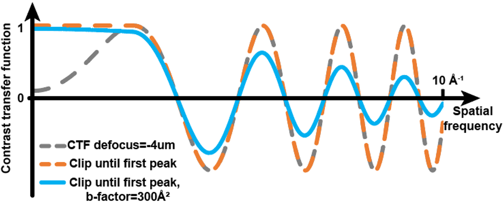
Fig. 5. Effects of clip_first_peak_mode and bfactor on CTF.

### Practical notes

> _See [Training settings and workflow](#training-settings-and-workflow) for GPU memory, preview timing, learning-rate scheduling, and checkpoint continuation. Compare reconstruction quality on your data when changing model size or training settings._

## deconv

CTF deconvolution preprocessing that enhances low-resolution contrast and recovers information attenuated by the microscope contrast transfer function. Recommended for non–phase-plate data; skip for phase-plate data or if intending to use network-based CTF deconvolution.

### Key parameters

- `star_file` — Input STAR listing tomograms and acquisition metadata. Required parameter.

- `chunk_size` — If set, tomograms are processed in smaller cubic chunks to reduce memory usage. Useful for very large tomograms or limited RAM/VRAM. May create edge artifacts if chunks are too small. Default: `None`.
- `deconvstrength` — Scalar multiplier for deconvolution strength; increasing this emphasizes correction and low-frequency recovery but can introduce ringing/artifacts if set too high. Default: **1.0**.
- `highpassnyquist` — Fraction of the Nyquist used as a very-low-frequency high-pass cutoff; use to remove large-scale intensity gradients and drift; usually left at default. Default: **0.02**.
- `input_column` — STAR column used for input tomogram paths. Default: `"rlnTomoName"`.
- `ncpus` — Number of CPU workers for CPU-bound parts of deconvolution; increase on multi-core systems. Default: **4**.
- `output_dir` — Folder to write deconvolved tomograms (rlnDeconvTomoName entries point here). Default: `"./deconv"`.
- `overlap_rate` — Fractional overlap between adjacent chunks when chunking; larger overlaps reduce edge artifacts at cost of extra computation. Default: **0.25**.
- `phaseflipped` — If True, input is assumed already phase-flipped; otherwise the function uses defocus and CTF info to apply phase handling. Default: `False`.
- `snrfalloff` — Controls frequency-dependent SNR attenuation applied during deconvolution; larger values reduce high-frequency contribution more aggressively and can stabilize deconvolution on noisy data; smaller values preserve more high-frequency content but risk amplifying noise. Default: **1.0**.
- `tomo_idx` — If set, process only the tomograms listed by these indices (e.g., "1,2,4" or "5-10,15,16"). Default: `None`.

### Practical notes

> _Inspect deconvolved outputs visually for ringing or other artifacts after changing snrfalloff or deconvstrength. Use chunking plus a moderate overlap_rate (0.25–0.5) when memory is limited._

## make_mask

Generate masks to prioritize regions of interest. Masks improve sampling efficiency and training stability.

### Key parameters

- `star_file` — Input STAR listing tomograms and acquisition metadata. Required parameter.

- `density_percentage` — Percentage of voxels retained based on local density ranking; lower values create stricter masks (keep fewer voxels). Default: **50**.
- `input_column` — STAR column to read tomograms from (default **rlnDeconvTomoName**; falls back to **rlnTomoName** or **rlnTomoReconstructedTomogramHalf1** if absent). Default: `"rlnDeconvTomoName"`.
- `output_dir` — Folder to save mask MRCs; rlnMaskName is updated in the STAR. Default: `"mask"`.
- `patch_size` — Local patch size used for max/std local filters; larger values smooth detection of specimen regions; default works for typical pixel sizes. Default: **4**.
- `std_percentage` — Percentage retained based on local standard-deviation ranking; lower values emphasize textured regions. Default: **50**.
- `tomo_idx` — If set, process only the tomograms listed by these indices (e.g., "1,2,4" or "5-10,15,16"). Default: `None`.
- `z_crop` — Fraction of tomogram Z to crop from both ends; masks out top and bottom 10% each when set to 0.2. Use to avoid sampling low-quality reconstruction edges. Default: **0.2**.

### Practical notes

> _Defaults are suitable for most datasets; tune density/std percentages for very sparse specimens or dense, crowded volumes. If automatic masks miss specimen regions, edit boundaries in the STAR or provide manual masks._

## refine

Use refine for _IsoNet2_ missing-wedge correction (isonet2) or isonet2-n2n combined modes.

### Key parameters

- `star_file` — Input STAR listing tomograms and acquisition metadata. Required parameter.

- `arch` — Neural network architecture. Choose from three convolutional U-Nets or four configured Swin-Conv U-Nets; see the architecture descriptions below. Default: `"unet-medium"`.
- `batch_size` — Total batch size across GPUs; automatic sizing gives 4 on one GPU or 2 × GPU count on multiple GPUs. Choose a positive multiple of the GPU count. See [Training settings and workflow](#training-settings-and-workflow). Default: `"auto"`.
- `bfactor` — B-factor of the modeled forward CTF envelope. Positive values damp that envelope, asking `network` mode to learn more high-frequency compensation. Not a final prediction filter; see [CTF handling](#ctf-handling-ctf_mode). Default: **0**.
- `clip_first_peak_mode` — Low-frequency shaping of the forward CTF in `network` mode only: **0** keeps the original curve, **1** fills to the first-peak value, **2** uses a sine-based lower bound, and **3** uses a cosine-based lower bound. See [First-peak shaping](#first-peak-shaping-clip_first_peak_mode) for formulas and B-factor behavior. Default: **1**.
- `CTF_mode` — CTF treatment: `"None"` (no explicit correction), `"phase_only"` (sign correction), `"network"` (forward-filter the prediction for the loss), or `"wiener"` (filter the training target). **We strongly recommend `"network"` for CTF correction.** See [CTF handling](#ctf-handling-ctf_mode) for phase flags and prediction behavior. Default: `"network"`.
- `cube_size` — Training cube side in voxels. U-Net requires a multiple of 16; SCUNet requires a multiple of 48 or 64. Larger cubes increase context and memory demand; see [Training settings and workflow](#training-settings-and-workflow). Default: **96**.
- `deconvstrength` — Wiener inverse-strength parameter. Current training uses dataset default 1 rather than this CLI value; see [CTF handling](#ctf-handling-ctf_mode). Default: **1.0**.
- `do_phaseflip_input` — For active CTF modes and inputs not already phase flipped, apply `sign(CTF)` before training. Saved in the checkpoint and reused for prediction. Ignored in `None` mode. Default: `True`.
- `epochs` — Requested training epochs. With previews enabled, only complete `save_interval` blocks run; see [Training settings and workflow](#training-settings-and-workflow). Default: **50**.
- `gpuID` — GPUs to use, e.g., `"0,1"`; omission uses all visible CUDA GPUs and respects `CUDA_VISIBLE_DEVICES`. See [Training settings and workflow](#training-settings-and-workflow). Default: `None`.
- `highpassnyquist` — Wiener very-low-frequency cutoff as a fraction of Nyquist. Current training uses dataset default 0.02 rather than this CLI value; see [CTF handling](#ctf-handling-ctf_mode). Default: **0.02**.
- `input_column` — Column name in STAR file to use as input tomograms. Default: `"rlnDeconvTomoName"`.
- `isCTFflipped` — Whether the supplied input tomograms are already phase flipped. Prevents another sign correction; distinct from amplitude deconvolution. Default: `False`.
- `learning_rate` — Initial AdamW learning rate; see [Training settings and workflow](#training-settings-and-workflow) for the cosine schedule and preview-block resets. Default: **3e-4**.
- `learning_rate_min` — Cosine-scheduler minimum. Equal to `learning_rate` by default, keeping the rate constant; see [Training settings and workflow](#training-settings-and-workflow). Default: **3e-4**.
- `loss_func` — Training objective: `L2`, `L1`, `Huber`, or `FSC`. See [Loss functions](#loss-functions-loss_func) for definitions and training behavior. Default: `"L2"`.
- `method` — `isonet2` for single-map missing-wedge correction, or `isonet2-n2n` for paired-half correction and denoising. `auto` selects from STAR columns and requires an explicit choice when both full and half maps are present. Default: `"auto"`.
- `mixed_precision` — If True, uses float16/mixed precision to reduce VRAM and speed up training. Default: `True`.
- `mw_weight` — For `isonet2-n2n`, positive values enable `n2n_loss + mw_weight × mw_loss`; see [Loss functions](#loss-functions-loss_func). Values <= 0 use the unmasked cross-half loss. Does not alter the `isonet2` objective. Default: **-1** (disabled).
- `ncpus` — Number of CPUs to use for data processing. Default: **16**.
- `noise_level` — Added noise standard deviation in normalized intensity units, for single-map `isonet2` only. Keep 0 for paired-half training; see [Training settings and workflow](#training-settings-and-workflow). Default: **0**.
- `noise_mode` — Simulated-noise reconstruction filter: `nofilter`, `ramp`, or `hamming`. Used for positive single-map noise augmentation; see [Training settings and workflow](#training-settings-and-workflow). Default: `"nofilter"`.
- `output_dir` — Directory to save trained model and results. Default: `"isonet_maps"`.
- `prev_tomo_idx` — Tomogram indices for previews, e.g., `"1,2,4"` or `"5-10,15"`. Used only when previews are enabled. Default: **1**.
- `pretrained_model` — Checkpoint weights and model configuration to load. Optimizer/scheduler state is initialized afresh; repeat consistent training settings as explained in [Training settings and workflow](#training-settings-and-workflow). Default: `None`.
- `random_rot_weight` — Probability of arbitrary-axis rotation per batch, from 0 to 1; otherwise a predefined right-angle rotation is selected. **0.2 means 20%**. See [Training settings and workflow](#training-settings-and-workflow). Default: **0.2**.
- `save_interval` — Epochs per preview block, interval for numbered checkpoint copies, and cosine-scheduler `T_max`; the main checkpoint is saved each epoch. See [Training settings and workflow](#training-settings-and-workflow). Default: **10**.
- `snrfalloff` — Wiener SNR-falloff parameter. Current training uses dataset default 0 rather than this CLI value; see [CTF handling](#ctf-handling-ctf_mode). Default: **0**.
- `with_preview` — Predict selected tomograms after each complete `save_interval` training block; optimizer/scheduler state resets between blocks. See [Training settings and workflow](#training-settings-and-workflow). Default: `True`.


Fig. 5. Effects of clip_first_peak_mode and bfactor on CTF.

### Neural network architectures (`arch`)

The architecture controls how the network represents the 3D correction. It is independent of `method`: the same architectures can be used with `isonet2` and `isonet2-n2n`. All variants have four downsampling steps, an encoder and decoder connected by skip connections, and a residual output that adds the learned correction to the input volume.

**Convolutional U-Net.** These networks extract features using 3×3×3 convolutions, batch normalization, and LeakyReLU activations. Strided convolutions reduce spatial resolution in the encoder; transposed convolutions restore it in the decoder. Concatenated skip connections pass encoder features directly to the corresponding decoder stages, preserving spatial detail while the bottleneck processes features at 1/16 of the input resolution.

| Architecture | Encoder and bottleneck channels | Capacity and resource tradeoff |
| --- | --- | --- |
| `unet-small` | 16, 32, 64, 128, 256 | Narrowest U-Net; lowest memory and computation demand within this family at the same cube and batch size. |
| `unet-medium` (default) | 32, 64, 128, 256, 320 | Intermediate U-Net width and resource demand. |
| `unet-large` | 64, 128, 256, 320, 320 | Wider features, especially at high spatial resolution; higher memory and computation demand than the smaller U-Nets. |

**Swin-Conv U-Net (SCUNet) — experimental.** All SCUNet variants are experimental and provided without any guarantee of reconstruction quality or stability. They are available only through the command line and are not available in the GUI.

These networks combine convolutional features with windowed self-attention in a 3D U-Net structure. Each hybrid block splits its channels between a convolution branch and an attention branch, then mixes the results. Alternating regular and shifted attention windows let features interact across neighboring windows. The convolution branch uses filter response normalization, which computes normalization per sample rather than using batch statistics; the attention branch uses layer normalization. Encoder and decoder features are combined through additive skip connections.

| Architecture | Encoder and bottleneck channels | Hybrid blocks and resource tradeoff |
| --- | --- | --- |
| `scunet-small` | 32, 64, 128, 256, 512 | Two hybrid blocks at each of nine stages: four encoder stages, the bottleneck, and four decoder stages (18 blocks total). Includes attention at full resolution. |
| `scunet-medium` | 64, 128, 256, 512, 1024 | Same 18-block arrangement as `scunet-small`, with wider features and greater memory and computation demand. |
| `scunet-fast` | 32, 64, 128, 256, 512 | Replaces hybrid processing at the full-resolution encoder and decoder stages with convolutions. Retains two hybrid blocks at each of seven lower-resolution stages (14 blocks total), reducing the cost of attention compared with `scunet-small`. |
| `scunet-fast-large` | 64, 128, 256, 512, 1024 | Same 14-block arrangement as `scunet-fast`, with wider features. Reduces the cost of full-resolution attention compared with `scunet-medium`. |

**Cube sizes.** U-Net requires `cube_size` divisible by 16. SCUNet additionally partitions each feature map into attention windows, so use a multiple of 48 or 64, such as **64, 96, 128, or 192**. The implementation selects a window side of 3 when the input cube size is divisible by 3, and 4 otherwise. A size such as 80 is divisible by 16 but does not satisfy SCUNet's window requirements.

**Choosing a variant.** `unet-medium` is the default. Within the U-Net family, `unet-small` reduces resource demand and `unet-large` increases feature width. For SCUNet, the fast variants retain attention at lower resolutions while using convolutions at full resolution. Actual GPU memory use and runtime also depend on cube size, batch size, and mixed precision; there is no fixed memory ranking across the two families. Larger models do not guarantee better reconstruction, so compare results on the same data and training settings.

When `pretrained_model` is supplied, the architecture saved in the checkpoint overrides `arch`. The refine GUI currently exposes the three U-Net choices; the four configured SCUNet variants can be selected through the command line, for example:

```bash
isonet.py refine tomograms.star --arch scunet-fast --cube_size 96
```

`scunet-large` has no width/block configuration in this version and cannot be used. HSFormer and VTUnet have no active model-selection paths.

### CTF handling (`CTF_mode`)

`CTF_mode` specifies how training handles the microscope contrast transfer function (CTF), independently of the network architecture and missing-wedge correction. The CTF can reverse the sign of some spatial frequencies and attenuate their amplitudes. **Phase flipping** corrects the sign reversals; **amplitude compensation** addresses attenuation. Phase flipping alone does not restore amplitudes.

Both `denoise` and `refine` accept the case-sensitive values `"None"`, `"phase_only"`, `"network"` (default), and `"wiener"`. All four are available in the GUI, where `network` is also selected by default.

**We strongly recommend `CTF_mode="network"` for CTF correction in both `refine` and `denoise`, over `phase_only` or `wiener`.** This mode trains the network to compensate for CTF attenuation by applying the forward CTF to its prediction before comparison with the observations. `network` is the default. Use `--CTF_mode None` when no explicit CTF correction is intended.

In the table below, `P` is the network prediction, `T` is the training target, `C` is the modeled CTF, `W` is the Wiener filter, and `loss` is the selected `loss_func`. Products such as `C × P` mean multiplication in Fourier space followed by transformation back to real space. The formulas describe the comparison after any phase flipping; for `isonet2-n2n`, comparisons are made in both cross-half directions and can additionally use `mw_weight`.

| Mode | Training comparison | Meaning of the network output |
| --- | --- | --- |
| `"None"` | `loss(P, T)`; no explicit CTF phase or amplitude filtering | Learns from the supplied data with their existing CTF/preprocessing. Select this when no additional CTF treatment is intended, including data already processed to the desired phase and amplitude convention. Missing-wedge correction and denoising still operate. |
| `"phase_only"` | Optional phase flipping, then `loss(P, T)` | Learns in the phase-corrected intensity convention when phase flipping is enabled or was already performed. There is no explicit amplitude deconvolution; the CTF amplitude envelope remains in the training target. |
| `"network"` (default) | `loss(C × P, T)` | Learns an output whose CTF-filtered version matches the observations. The CTF is applied to the **prediction before the loss**, rather than to the network input. This trains the network to compensate for attenuation; it does not explicitly divide the data by the CTF. |
| `"wiener"` | `loss(P, W × T)` | Learns to match a Wiener-filtered target. The amplitude correction is prescribed by a regularized inverse filter, rather than learned through a forward CTF comparison. |

For `network`, frequencies close to a CTF zero provide little direct training constraint on the unfiltered prediction; compensation there depends on information learned from the data. For `wiener`, the filter has the form `W = C / (C² + 1/SNR)`, using an assumed frequency-dependent SNR. The regularizing term limits direct inverse amplification near CTF zeros. Neither approach guarantees recovery of information absent from the observations.

**Phase-flip flags.** `isCTFflipped` describes the data supplied to the command; `do_phaseflip_input` controls whether IsoNet performs a phase flip. For any active CTF mode:

| Input/settings | Training behavior |
| --- | --- |
| `isCTFflipped=True` | Treats inputs as already phase flipped, skips another sign correction, and uses `abs(C)` and `abs(W)` where those filters are needed. |
| `isCTFflipped=False`, `do_phaseflip_input=True` (defaults) | Multiplies the training volumes by `sign(C)` in Fourier space, then uses filter magnitudes. |
| Both flags `False` | Leaves input signs unchanged and retains signed filters. In `phase_only`, this applies no CTF correction. |

With `CTF_mode="None"`, neither flag triggers CTF phase correction. Set `isCTFflipped` from the actual preprocessing history of the input files; phase flipping is distinct from amplitude deconvolution.

**Refine's missing-wedge filling step.** For both `network` and `wiener`, preliminary network predictions are multiplied by the CTF before being used to fill the missing wedge. This keeps the filled training volumes in observation space. The subsequent training comparison still follows the table above: filter the new prediction in `network`, or filter the target in `wiener`.

**Related controls and metadata.** The current implementation builds a radial 3D CTF from one defocus value per STAR row, with phase shift fixed to zero. It uses `rlnPixelSize` (Å/pixel), `rlnDefocus` (Å), `rlnVoltage` (kV), `rlnSphericalAberration` (mm), and `rlnAmplitudeContrast`. This is a per-tomogram model; it does not model defocus variation across individual tilts or locations.

- `clip_first_peak_mode` modifies the low-frequency forward CTF in `network` mode only. See [First-peak shaping](#first-peak-shaping-clip_first_peak_mode) below for the four rules, their effect on training, and their interaction with the B-factor envelope.
- `bfactor` modifies the modeled forward CTF envelope. A positive value damps the modeled high-frequency response, so matching the observations in `network` mode asks the network to compensate more at those frequencies. It is not a separate sharpening filter applied during prediction. The Wiener target filter is constructed with B-factor zero.
- `snrfalloff`, `deconvstrength`, and `highpassnyquist` define the Wiener filter's assumed SNR falloff, inverse strength, and very-low-frequency suppression. **Current implementation limitation:** the main `denoise`/`refine` training path does not forward these CLI values to the dataset. Wiener training targets therefore use dataset defaults **0**, **1**, and **0.02**, respectively. Changing those arguments currently does not tune the training target filter. The separate `deconv` command has its own parameter handling.

**Prediction and checkpoints.** `predict` reads `CTF_mode` and `do_phaseflip_input` from the checkpoint. For an active mode, it phase flips prediction inputs only when the saved flag is true and the prediction command's `isCTFflipped` is false. It then returns the direct network output; there is no final CTF multiplication or Wiener amplitude filter. Supply prediction inputs with preprocessing consistent with training. The prediction input's phase-flip status must be specified again with `isCTFflipped`.

For example, for inputs that have not already been phase flipped:

```bash
isonet.py refine tomograms.star --CTF_mode phase_only --isCTFflipped False --do_phaseflip_input True
isonet.py refine tomograms.star --CTF_mode network --isCTFflipped False --do_phaseflip_input True
isonet.py refine tomograms.star --CTF_mode wiener --isCTFflipped False --do_phaseflip_input True
```

#### First-peak shaping (`clip_first_peak_mode`)

This parameter changes the **low-frequency part of the modeled forward CTF** in `CTF_mode="network"`. It is available in the GUI when `network` is selected. The default is **1**. Other CTF modes ignore this setting and construct their CTF with first-peak shaping disabled.

**Recommended pairings:** use mode **1** with `loss_func=L2`, or mode **0** with `loss_func=FSC`.

In network mode, training compares `C × prediction` with the target. A small modeled CTF value asks the network for a larger output to match the same target. Raising the modeled response before its first peak reduces the compensation requested in that low-frequency range. These settings therefore affect broad contrast and intensity gradients through training; they are not filters applied to the final prediction.

**Definitions.** The implementation samples a signed radial CTF and locates its first local maximum after the initial B-factor envelope is applied. Let `p` be that peak's sample index, `A = C(p)` its value, and `u = i/p` the relative position of a sample before it (`0 <= i < p`). Peak position depends on the microscope parameters, pixel size, B-factor, and sampling; it is not a manually selected resolution cutoff or the first CTF zero.

| Mode | Rule before the first peak | Effect on the modeled low-frequency response |
| --- | --- | --- |
| **0 — no shaping** | Keep `C(i)`. | Retains the original low-frequency curve, including small values that can ask for strong compensation. B-factor envelope handling still applies. |
| **1 — constant fill (default)** | Set `C(i) = A`. | With B-factor zero, creates a flat response from zero frequency up to the first peak. Raises the weak pre-peak response to the peak value and reduces the requested compensation there. |
| **2 — sine-based lower bound** | Set `C(i) = max(C(i), A × (1 - sin(pi × u / 2)))`. | The lower bound starts at `A` and falls toward zero at the peak. The original CTF is retained wherever it is larger than the bound; the whole first lobe is not replaced by a sine curve. |
| **3 — cosine-based lower bound** | Set `C(i) = max(C(i), A × cos(pi × u / 2))`. | Also starts at `A` and falls toward zero. For a positive peak, this bound is at least as high as the mode-2 bound throughout the pre-peak interval, so it can raise the modeled response over a broader frequency range. |

For example, halfway to a positive peak (`u=0.5`), mode 1 uses `A`, mode 2 has a lower bound of approximately `0.293 × A`, and mode 3 has a lower bound of approximately `0.707 × A`. Modes 2 and 3 keep the original CTF instead if it exceeds the respective bound. These numbers describe filter construction, not fixed changes in output contrast.

The shaping step changes only samples **before** the detected peak; the peak sample and subsequent oscillations are retained. In the current implementation, the B-factor envelope is applied **before peak selection and again after shaping**. The table therefore describes the intermediate shaping step; with a nonzero B-factor, even mode 1 is not a perfectly flat final filter. When B-factor is zero, both envelope multiplications are unity.

Mode 0 retains the unmodified first lobe. Mode 1 uses a constant fill, while modes 2 and 3 preserve the original response wherever it exceeds their bounds. Compare results with the same data and training settings when changing modes: no option guarantees better contrast or reconstruction, and changing this parameter does not change the microscope's physical CTF.

```bash
isonet.py refine tomograms.star --CTF_mode network --clip_first_peak_mode 1
isonet.py refine tomograms.star --CTF_mode network --clip_first_peak_mode 2
isonet.py refine tomograms.star --CTF_mode network --clip_first_peak_mode 3
```

### Loss functions (`loss_func`)

The loss measures the difference between a network prediction and its training target; training minimizes it. Both `refine` and `denoise` accept the case-sensitive names `L2`, `L1`, `Huber`, and `FSC`. The default is `L2`. All four are also available in the GUI's Loss Function menu.

**Recommended settings for `CTF_mode=network`:** use `loss_func=L2` with `clip_first_peak_mode=1`, or `loss_func=FSC` with `clip_first_peak_mode=0`. L2 with mode 1 is the default pairing. For FSC, set `clip_first_peak_mode=0` explicitly; selecting a loss does not automatically change the first-peak mode. Other CTF modes ignore `clip_first_peak_mode`.

For the voxel-based losses below, let `e = prediction - target`. The mean is taken over all voxels, channels, and samples in the training batch.

| Value | Definition | What it measures |
| --- | --- | --- |
| `L2` (default) | `mean(e²)`, mean squared error | Penalizes large voxel errors quadratically. Large residuals contribute more strongly than with L1. Sensitive to intensity differences, including large outliers. |
| `L1` | `mean(abs(e))`, mean absolute error | Penalizes voxel errors linearly, reducing the relative influence of large residuals compared with L2. Still measures absolute intensity differences. |
| `Huber` | Mean of `0.5 × e²` when `abs(e) < 1`, otherwise `abs(e) - 0.5` | Uses a quadratic penalty near zero and a linear penalty for larger errors. The implementation fixes the transition parameter `delta=1.0`; this threshold is in the intensity units used during training, after preprocessing and normalization. |
| `FSC` | `1 - mean(FSC over frequency shells)`, averaged over volumes/channels | Measures normalized correlation between prediction and target in Fourier space, rather than absolute voxel error. Shells receive equal weight regardless of how many Fourier coefficients they contain. |

**How FSC is computed.** For each volume/channel, the implementation takes the 3D Fourier transforms `P` and `T` of the prediction and target in float32. For each radial shell `s`, it computes:

```text
FSC(s) = Re(sum(P(k) × conjugate(T(k))))
         / sqrt(sum(abs(P(k))²) × sum(abs(T(k))²) + 1e-6)
```

The sums run over Fourier coefficients in that shell. Shell indices are integer distances from the Fourier origin; populated shells from 1 through half the smallest volume dimension are included. The zero-frequency (DC) shell is excluded, and each shell correlation is clamped to [-1, 1]. The loss is one minus the mean shell correlation, followed by an average over volumes/channels. A value near 0 indicates strong positive correlation; 1 corresponds to mean correlation near 0, and 2 to mean correlation near -1. If either volume has zero power in a shell, that shell contributes correlation 0.

FSC does not directly constrain the mean intensity because it excludes DC, and its normalization makes it largely insensitive to positive intensity rescaling except at very low power, where the stabilizing constant matters. It also gives individual high-frequency shells the same weight as low-frequency shells. An FSC training loss is a fit to the training target; it is not an independent half-map resolution measurement or a guarantee of reconstruction quality.

**Targets used during training.** In `isonet2`, the target is a rotated training volume whose missing wedge has been filled using the current network prediction; the input has a missing wedge reapplied. The selected loss compares the new prediction with that target. In `isonet2-n2n`, each half-volume prediction is compared with the opposite half's rotated, filled target, and the two losses are averaged. In `denoise`, a prediction from one noisy half is compared with the other noisy half. These are self-supervised targets, not clean ground-truth volumes. When CTF filtering is enabled, `CTF_mode=network` filters the prediction before comparison, while `CTF_mode=wiener` filters the target.

**Missing-wedge weighting.** For `isonet2-n2n` with `mw_weight > 0`, the unmasked objective is replaced by `n2n_loss + mw_weight × mw_loss`. Both prediction and target are Fourier-masked and transformed back to real space before the selected loss is evaluated. With `M` the original observed-frequency mask and `R` its rotated version, `n2n_loss` uses `R × M`, and `mw_loss` uses `R × (1 - M)`: frequencies in the reapplied missing wedge that are supported by the rotated observations. Each component is averaged over the two cross-half comparisons. With `mw_weight <= 0` (default **-1**), training uses the mean unmasked cross-half loss. In the current implementation, `mw_weight` does not alter the `isonet2` objective; its masked components are calculated for reporting.

Loss values have different scales and meanings across these choices. Compare training curves within the same loss and preprocessing settings, and assess output quality separately. Changing `loss_func` does not change the architecture or guarantee an improvement.

```bash
isonet.py refine tomograms.star --loss_func Huber
isonet.py refine tomograms.star --CTF_mode network --loss_func L2 --clip_first_peak_mode 1
isonet.py refine tomograms.star --CTF_mode network --loss_func FSC --clip_first_peak_mode 0
```

### Training settings and workflow

These notes apply to `refine` and, where indicated, `denoise`. They describe the current implementation, including settings whose behavior differs from their names.

#### GPU selection, batch size, and cube size

`gpuID` selects the GPUs used by the command. If omitted, IsoNet uses all visible CUDA GPUs, respecting `CUDA_VISIBLE_DEVICES`. For example, with `CUDA_VISIBLE_DEVICES=2,3`, `--gpuID 0,1` selects both visible devices using local indices.

`batch_size` is the **total** requested batch size across GPUs. Its default is `"auto"` in both commands: 4 for one GPU, or twice the GPU count for multiple GPUs.

| Selected GPUs | Automatic total batch size | Samples per GPU |
| --- | --- | --- |
| 1 | 4 | 4 |
| 2 | 4 | 2 |
| 4 | 8 | 2 |

The training loop calculates per-GPU batch size using integer division. Choose a positive multiple of the selected GPU count, with at least one sample per GPU. For example, `batch_size=5` on two GPUs gives two samples per GPU, effectively four per step; a total smaller than the GPU count produces a zero per-GPU batch size.

Each GPU holds a model replica and its local batch; GPU memory is not pooled. Reducing batch size reduces activation memory. Increasing `cube_size` increases the spatial context and memory demand: doubling the side length makes each input cube contain eight times as many voxels, although total memory use also depends on the architecture. U-Net requires a multiple of 16; SCUNet requires a multiple of 48 or 64. See [Neural network architectures](#neural-network-architectures-arch) for the architecture details.

#### Noise augmentation (`noise_level`, `noise_mode`)

Artificial noise addition is implemented for single-map `method=isonet2`. Keep `noise_level=0` for `isonet2-n2n`; that method learns from paired noisy halves and does not use this artificial-noise addition. The separate `denoise` command also uses paired halves and has no noise-augmentation arguments.

For a positive `noise_level`, the single-map input is augmented as follows, after the training volume's normalization and missing-wedge reapplication:

```text
augmented_input = input + noise_level × (noise - mean(noise)) / std(noise)
```

The noise tensor is normalized to zero mean and unit population standard deviation. Thus, `noise_level=0.1` adds noise with standard deviation 0.1 **in normalized training intensity units**. It does not mean 10% of the raw tomogram intensity or a specified SNR. The single-map training volume is percentile-normalized using its 4th and 96th percentiles; the target does not receive this added noise.

`noise_mode` controls filtering during simulated-noise reconstruction:

| Value | Noise generation |
| --- | --- |
| `nofilter` (default) | Backprojection without a reconstruction filter. |
| `ramp` | Backprojection with a ramp filter. |
| `hamming` | Backprojection with a Hamming filter. |

These choices change the noise's spatial/frequency structure; they do not select the loss or CTF mode. The current generator uses simulated tilt angles from -60° to +60° in 3° steps. A positive single-map noise level generates 1,000 noise cubes under `output_dir/noise_volumes`, adding startup computation, memory use, and disk storage. With `noise_level=0`, this generation and noise addition are skipped.

#### Rotations (`random_rot_weight`)

`random_rot_weight` is a probability between 0 and 1, evaluated per training batch in `isonet2` and `isonet2-n2n`. The default **0.2 means 20%**, rather than 0.2%.

With that probability, training samples an arbitrary axis and an angle from 0 to 2π and rotates the volumes and Fourier mask using grid sampling. The current implementation uses nearest-neighbor sampling with reflection padding. Otherwise, it chooses from the predefined list of combinations of 90° rotations, implemented with `torch.rot90`.

A value of 0 uses only predefined right-angle rotations; 1 uses arbitrary rotations for every batch. Increasing the value changes augmentation diversity and resampling behavior; it does not increase the number of samples per epoch. This setting is not exposed by the paired-half `denoise` command.

#### Epochs, checkpoints, and previews

`epochs` requests the number of training epochs. An epoch traverses the training loader built from the STAR's sampled subvolumes; it is not a prediction pass over every full tomogram.

With `with_preview=True` (default), both commands train in blocks of `save_interval` epochs and predict the tomograms selected by `prev_tomo_idx` after each block. Full-volume prediction adds runtime and output files; limiting the preview indices reduces that work.

**Current block behavior:** only complete blocks run. For `epochs=55` and `save_interval=10`, training runs 50 epochs and generates previews at 10, 20, 30, 40, and 50. With `epochs=5` and `save_interval=10`, no training block runs. Use positive integer values and make `epochs` a multiple of `save_interval` when previews are enabled.

With `with_preview=False`, one training call runs all requested epochs without preview prediction. The main checkpoint is overwritten after each epoch, and numbered checkpoint copies are written at `save_interval` multiples. The interval therefore does not mean that weights are saved only once every several epochs.

Each preview block invokes a new training call. Model weights and loss history carry forward, while the optimizer, learning-rate scheduler, and mixed-precision scaler are recreated. Preview blocks therefore affect optimization as well as output frequency.

#### Learning rate (`learning_rate`, `learning_rate_min`)

Training creates an AdamW optimizer at `learning_rate` and a cosine-annealing scheduler whose minimum is `learning_rate_min`. Both defaults are **3e-4**, so the default learning rate remains constant. A lower minimum enables a varying learning rate; for example, `learning_rate=3e-4` and `learning_rate_min=3e-5` define a tenfold range.

The scheduler's `T_max` is `save_interval`, not the total `epochs`. With previews enabled, each block starts a fresh optimizer and cosine schedule. Without previews, the scheduler continues through the whole training call: it reaches its minimum after `save_interval` epochs and can increase again if training continues beyond that point. Changing `save_interval` can therefore change the learning-rate trajectory even when previews are disabled.

#### Continuing from a checkpoint (`pretrained_model`)

`pretrained_model` starts from saved network weights and loss history. The model loader also reads the saved method, architecture, cube size, CTF mode, and input phase-flip setting (with compatibility defaults for older checkpoints).

The checkpoint contains **no optimizer, scheduler, or mixed-precision scaler state**. Those are initialized afresh, and `epochs` specifies additional requested training under the current command's block behavior. Numbered epoch labels are not continued from a stored global epoch counter; reusing an output directory can overwrite earlier checkpoint copies.

Keep the command's `method`, `arch`, `cube_size`, `CTF_mode`, and phase-flip settings consistent with the original training. The model object loads its configuration from the checkpoint, but the training dataset, filtering, and checkpoint metadata are still constructed from command arguments; those arguments are not all synchronized automatically with the loaded model.

Settings such as the B-factor, first-peak mode, noise augmentation, and rotation probability are not stored in the checkpoint and must be supplied again if the previous configuration is intended. Verify the input files' phase-flip status separately with `isCTFflipped`.

#### Training and preview masking

Missing-wedge masking is part of the `isonet2` and `isonet2-n2n` training algorithms. They mask the observed input contribution and reapply the wedge to rotated, filled volumes to build training examples. The separate `denoise` command trains directly on paired halves without refine's wedge-filling and reapplication steps. Neither training command accepts `apply_mw_x1`; the unused option and the Refine GUI switch have been removed.

**Preview masking** happens during the automatic prediction after each training block when `with_preview=True`. Both training commands call `predict` with its default `apply_mw_x1=True`. The prediction inputs are divided into cubes and filtered in Fourier space using the missing wedge defined by the STAR tilt limits. The network then predicts from those filtered inputs. This removes frequencies in the missing wedge from the prediction inputs; it does not mask a spatial region or apply a missing-wedge filter to the final output.

`apply_mw_x1` remains available in the `predict` command and the Predict GUI. To control it explicitly, run prediction separately with `--apply_mw_x1 True` or `--apply_mw_x1 False`. Automatic training previews keep the enabled default. Phase flipping remains controlled separately by the checkpoint's CTF settings and the input's `isCTFflipped` status.

### Practical notes

> _Choose arch, cube_size, and batch_size to fit your GPU memory. Larger architectures and cubes increase resource needs; assess reconstruction quality on your data. Enable mixed_precision to reduce VRAM use._

## predict

Apply a trained IsoNet model to tomograms to produce denoised or missing-wedge–corrected volumes. Prediction utilizes the model's saved cube size and CTF handling options, but allows for runtime adjustments.

### Key parameters

- `star_file` — Input STAR describing tomograms to predict. Required parameter.

- `model` — Path to trained model checkpoint (.pt) for single-model prediction. Required parameter.
- `apply_mw_x1` — If True (default), build and apply the missing-wedge mask to cubic inputs before prediction. Default: `True`.
- `gpuID` — GPU IDs string (e.g., "0" or "0,1"); use multiple GPUs when available for speed. Default: `None`.
- `input_column` — STAR column used for input tomogram paths. This is only relevant if the network model is using method _IsoNet2_. Default: `"rlnDeconvTomoName"`.
- `isCTFflipped` — Whether prediction inputs are already phase flipped. Otherwise the checkpoint's CTF mode and `do_phaseflip_input` determine whether to phase flip before inference. Default: `False`.
- `output_dir` — Folder to save predicted tomograms; outputs are recorded in the STAR as rlnCorrectedTomoName or rlnDenoisedTomoName depending on method. Default: `"./corrected_tomos"`.
- `output_prefix` — Prefix to append to predicted MRC files. Default: `""` (empty string).
- `padding_factor` — Cubic padding factor used during tiling to reduce edge effects; larger padding reduces seams but increases computation. Default: **1.5**.
- `tomo_idx` — Process a subset of STAR entries by index. Default: `None`.

### Practical notes

> _Match prediction cube/crop sizes and padding to the network's training settings (these come from the model object). When using CTF-aware models, ensure isCTFflipped and STAR defocus/CTF fields are correct._

# 4. FAQs

## Q: When should I use even/odd paired versus full tomograms?

Use even/odd paired tomograms when you want to use `--method isonet2-n2n`, which is generally recommended as it provides better denoising. Use full tomograms for single-map training (`--method isonet2`) when movies and tilt-series are not available.

## Q: How many subtomograms should I extract per tomogram/epochs should I train for?

The default is 3000 subtomograms in total per epoch. Changing this default is not usually necessary unless you would like to increase the number of subtomograms for a particularly dense tomogram. Reducing this number is not recommended.

Increasing the number of subtomograms is analogous to increasing the number of training epochs, as subtomograms are extracted during training (as opposed to before, in IsoNet1). Because _IsoNet2_ does not currently use a specialized learning rate scheduler, it is acceptable to keep the default and simply halt training when the loss has converged. We also do not recommend training for fewer than 50 epochs.

## Q: How can I reduce memory usage during training?

- Enable mixed_precision for float16 training
- Reduce batch_size (minimum being the number of GPUs you have)
- Choose a smaller network architecture
- Reduce cube_size

## Q: Why can refine run out of memory on one GPU but work on two GPUs?

By default, `batch_size` is chosen automatically. When using one GPU, the default is **4**. When using multiple GPUs, the default is **2 x number_of_GPUs**, so the work is split across devices. That means a single-GPU run can place more memory pressure on one device than a multi-GPU run.

If refine runs out of memory on a single GPU, first set `batch_size` manually to **3**, **2**, or **1**. If memory is still insufficient, reduce `cube_size` to **96** or choose a smaller network architecture. Lowering `batch_size` is usually the first thing to try.

## Q: When should I use the CTF deconvolution module?

Use the **_deconv_** module in two scenarios:

1. If you have full tomograms instead of even/odd tomograms for missing wedge correction, similar to IsoNet1.
2. If you have even/odd tomograms and want to quickly generate a mask for refinement. Enable `create_average` in **_prepare_star_** to create averaged tomograms, then use **_deconv_** to generate deconvolved tomograms as a base for mask generation.

## Q: When should I create masks?

Masks prioritize regions of interest (specimen areas) during training, which improves sampling efficiency and training stability by focusing the network on relevant areas rather than empty space. We recommend always creating a mask for refinement. They are not necessary for **_denoise_**.

## Q: My masks are missing specimen regions. What can I do?

You can regenerate the mask using less strict (higher values) `density_percentage` and `std_percentage` parameters, manually edit `rlnMaskBoundary` in the .star file, or provide your own manual masks through the `mask_folder` parameter.

## Q: Which CTF_mode should I use (Network or Wiener) during refine?

`network` trains against observations after applying the forward CTF to the prediction; `wiener` trains against an explicitly Wiener-filtered target. `phase_only` corrects signs without amplitude compensation, and `None` leaves CTF treatment to the input preprocessing. See [CTF handling](#ctf-handling-ctf_mode) for the phase-flip settings, prediction behavior, and the current limitation that Wiener training uses dataset defaults rather than the CLI filter-tuning values. Reconstruction quality depends on the data and settings; no mode guarantees higher resolution or better results than the separate `deconv` command.

## Q: What value should I use for mw_weight?

We recommend using higher weights for missing wedge correction (20–200) to prioritize missing wedge reconstruction over general denoising. Keeping `mw_weight` at the default value of 0 disables masked loss, meaning a single loss is used to describe both missing wedge correction and denoising.
